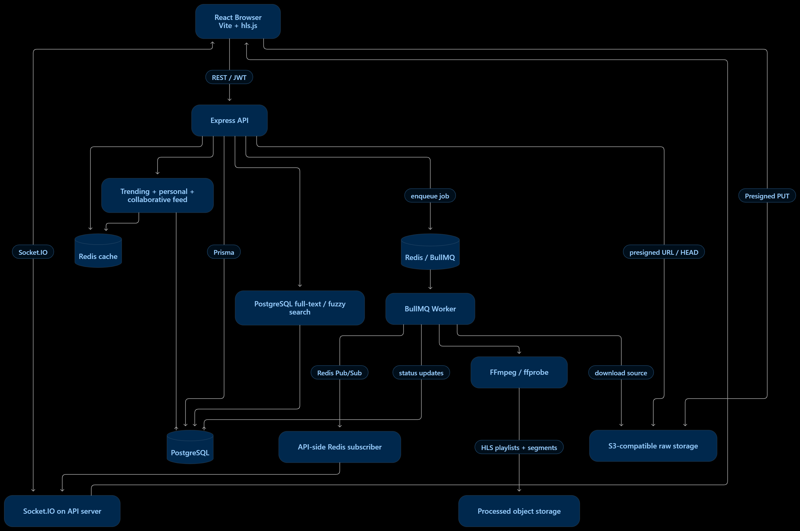

# MediaFlow

A Distributed video streaming platform with direct-to-storage uploads, asynchronous FFmpeg transcoding, adaptive HLS playback, real-time processing updates, and a hybrid search and recommendation layer.

## Overview

MediaFlow separates latency-sensitive request handling from expensive, failure-prone media work. The Express API stays lightweight (auth, metadata, orchestration) while uploads go straight to object storage and transcoding runs in independent BullMQ workers.

> **Design principle:** keep user-facing requests fast; move CPU-heavy and failure-prone media processing into background workers.

| Concern | Implementation | Benefit |
|---|---|---|
| Large file transfer | Presigned S3-compatible URLs (`modules/video/controllers/upload.js`) | Video bytes go browser → storage, not through Express |
| Expensive transcoding | `queues/videoQueue.js`, `worker.js` | FFmpeg runs outside the API request lifecycle |
| Persistent state | PostgreSQL + Prisma (`prisma/schema.prisma`) | Relational constraints for users, videos, upload sessions, engagement, processing state |
| Job coordination | BullMQ + Redis | Jobs can wait, retry, and be consumed by separate worker processes |
| Live progress | Socket.IO + Redis Pub/Sub (`websocket.js`, `redis/publisher.js`) | Clients get status updates without constant polling |
| Search relevance | `modules/search/services/search.service.js` | Full-text, substring, prefix and trigram matching combined |
| Feed personalization | `modules/recommendation/services/hybridRank.service.js` | Trending, personal and collaborative candidates in one ranked feed |

## Architecture




**Upload and processing flow**

1. The client requests a presigned URL from the API and uploads the raw file directly to storage.
2. The client calls complete-upload; the API verifies the object exists (HEAD), updates the video status, and enqueues a job.
3. A worker downloads the source, extracts metadata with ffprobe, generates a thumbnail, transcodes HLS renditions, and uploads the outputs.
4. The worker updates status in PostgreSQL and publishes progress over Redis Pub/Sub.
5. The API-side subscriber forwards events to connected clients via Socket.IO.
6. On success the video becomes `READY` and is playable through HLS.js.

## Key Engineering Challenges

### 1. Large uploads and storage boundaries
*Files: `upload.js`, `directUpload.controller.js`, `chunkUpload.controller.js`, `completeUpload.js` (under `modules/video/controllers/`)*

Uploads use presigned PUT URLs, with upload state tracked in PostgreSQL. File transfer, metadata persistence, and upload completion are separate operations, so success in one does not guarantee the others. The API therefore verifies the stored object before marking a video for processing.

The primary frontend path (`FRONTEND/src/page/videoUpload/UploadPage.jsx`) uses a single presigned PUT with a backend-stream fallback. Chunk-upload endpoints exist in the backend but are not yet wired into the UI, so end-to-end resumable uploads are not currently provided.

### 2. Asynchronous processing and retries
*Files: `completeUpload.js`, `queues/videoQueue.js`, `worker.js`, `videoRetry.controller.js`*

The hard part is keeping a database state machine consistent with a separate queue. A retry may repeat work that partially completed, so processing is designed around explicit status transitions, queue coordination, and idempotent recovery from partial output.

### 3. Real-time updates across processes
*Files: `websocket.js`, `redis/publisher.js`, `worker.js`*

The API server owns Socket.IO connections; workers publish progress through Redis Pub/Sub, so no memory is shared between processes. Neither a WebSocket connection nor a Pub/Sub message is durable: clients disconnect and messages can be missed. **PostgreSQL is the source of truth for processing state**, and clients can always recover by reading it.

### 4. Search and feed relevance
*Files: `search.service.js`, `hybridRank.service.js`, `trending.service.js`, `collaborative.service.js`*

Search blends full-text, substring, prefix, and trigram similarity on indexed PostgreSQL data. The feed merges trending, personal, and collaborative candidates into a hybrid score, with Redis caching computed results. The trade-offs are retrieval quality vs. query cost, and cache freshness vs. ranking complexity. This is a practical heuristic baseline, not a machine-learning recommender.

## Features

- **Upload:** presigned S3 URLs, direct browser upload, upload session tracking
- **Processing:** asynchronous FFmpeg transcoding, HLS renditions, thumbnails, live status events
- **Playback:** adaptive HLS streaming, metadata tracking, public/private media handling
- **Discovery:** full-text, fuzzy, prefix and trigram search; trending, personal and collaborative feed with hybrid ranking

## Tech Stack

| Layer | Technologies |
|---|---|
| Backend | Node.js, Express, Prisma, PostgreSQL, Redis, BullMQ, FFmpeg/ffprobe, S3-compatible storage, Socket.IO |
| Frontend | React, Vite, HLS.js, Socket.IO client, Zustand, Tailwind CSS |

## Repository Structure

```text
Media-Flow/
├── BACKEND/
│   ├── config/
│   ├── modules/          # analytics, auth, feed, recommendation, search,
│   │                     # subscription, thumbnail, video
│   ├── prisma/
│   ├── queues/
│   ├── redis/
│   ├── services/
│   ├── server.js         # API entry point
│   ├── worker.js         # transcoding worker entry point
│   └── logger.js
├── FRONTEND/
│   ├── src/
│   └── public/
├── docs/architecture/
└── README.md
```

## Getting Started

**Prerequisites:** Node.js, PostgreSQL (with trigram support enabled), Redis, FFmpeg on `PATH`, and an S3-compatible bucket.

```bash
git clone https://github.com/ashishTpakhale/Media-Flow.git
cd Media-Flow

# Backend
cd BACKEND
npm install
cp .env.example .env        # configure DB, Redis, storage, JWT
npx prisma migrate deploy
npm run dev                 # API server
node worker.js              # transcoding worker (separate process)

# Frontend
cd ../FRONTEND
npm install
npm run dev
```

The API and worker run as separate processes and can be scaled independently.

## Known Limitations

- Resumable chunked upload exists server-side but is not used by the current UI.
- Recommendations are heuristic and signal-based, not ML-driven.
- Redis Pub/Sub delivery is best-effort; clients should re-sync status from the database after reconnecting.

## Roadmap

- Wire chunk upload into the frontend for resumable uploads
- Stronger idempotency and cleanup of partial transcoding output on retry
- Durable event delivery (e.g., status replay on reconnect)
- Evaluate learned ranking on top of the current hybrid signals

## Author

[Ashish Pakhale](https://github.com/ashishTpakhale)
